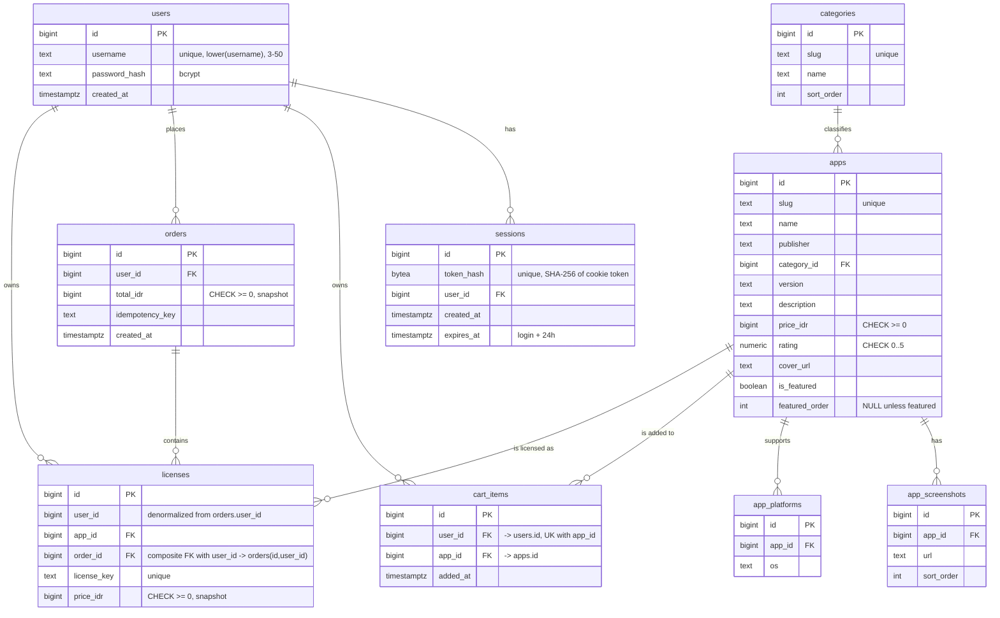

# FEAT-001 — Paladin storefront v1 — Database Design

This is the confirmed output of the schema-designer discipline (draft
ERD → advisory normalization review → batched migration plan) for the
Paladin v1 storefront. PostgreSQL 16 is the only datastore. The design
is greenfield: no table is inherited from an existing Paladin system.

## Phase 1 — Draft ERD

## Phase 2 — Normalization review (advisory)

**Result: 3NF for every table; the deliberate decisions below are
recorded as such, not left as unreviewed gaps.**

- **`licenses` is both the order line and the library entry.** A buyer's
  library is not a second table derived from order lines; it is the set
  of `licenses` rows for that user. This is deliberate. The requirement
  "the same app can never appear twice in a user's library"
  (`REQ-035`) is then a real `UNIQUE (user_id, app_id)` constraint, not a
  cross-table application check that can race. The row carries the
  checkout-time price snapshot (`price_idr`) required by
  `REQ-027`/`REQ-028`. There is no repeating group and no partial
  dependency: the key is `id`, and every non-key attribute depends on it.
  Splitting into `order_items` + `library` would reintroduce the
  duplicate-ownership race and add a table with no independent
  lifecycle.
- **Denormalized snapshots are intentional.** `licenses.price_idr`
  duplicates the current `apps.price_idr`, and `orders.total_idr`
  duplicates the sum of its lines. That is the point: orders are
  immutable and must survive a catalog price change (`REQ-027`), and the
  confirmation/list reads its total without re-summing. Two other
  candidate duplicates were deliberately **not** kept: a license's
  purchase date is `orders.created_at` (read through the existing join),
  and the app name is `apps.name` (the catalog is seed-immutable and
  `RESTRICT` blocks deleting a purchased app). Snapshot only what the
  requirement says must be frozen — the price — plus the order total;
  duplicating a name or date would be an unreviewed gap, not a snapshot
  requirement.
- **`cart_items` keeps a surrogate `id` and expresses its natural key
  as `UNIQUE (user_id, app_id)`.** The standard's "one surrogate primary
  key per table" rule is followed rather than making the pair the PK:
  `(user_id, app_id)` is the uniqueness requirement, and the unique
  constraint — not the PK — is what enforces "one line per app at
  quantity 1" (`REQ-015`, `REQ-018`). The API still addresses a line by
  `app_id`, never by `id`; the surrogate exists for consistency with
  every other table and for a future line-level feature.
- **`orders` has no stored `reference` column.** The display reference is
  computed in Go as `PAL-%04d` from `id` (`PAL-0001`, and `PAL-10000`
  once ids reach five digits — `%04d` pads, never truncates), and the
  order route parses the numeric suffix back to `id` before the
  user-scoped lookup. A stored default built from `nextval` would need
  a second sequence (gaps/drift) or double-consume the primary-key
  sequence, and `lpad(..., 4, '0')` silently truncates at five digits —
  a duplicate-reference defect avoided by not storing it.
- **`licenses.user_id` is transitively determined by `order_id`, but it
  is kept deliberately.** It is what allows `UNIQUE (user_id, app_id)`,
  the "never own the same app twice" security guarantee
  (`REQ-035`/`REQ-055`), which cannot span two tables without a
  trigger. The redundancy cannot drift: `orders` carries
  `UNIQUE (id, user_id)` and `licenses` references
  `(order_id, user_id) → orders(id, user_id)`, so a license whose user
  disagrees with its order is rejected by the database.
- **`categories` is referenced by the app, not duplicated into it.**
  Category slug/name is read through the join; there is no category text
  column on `apps`.
- **No `status` column conflates business state with deletion.** There is
  no `status` field anywhere in this schema, and no soft-delete columns:
  nothing in v1 is soft-deletable. Cart lines are truly deleted on
  removal/checkout; sessions are truly deleted on logout/expiry; orders
  and licenses are immutable and never deleted. If a later pass adds a
  lifecycle state to a seeded entity, it gets its own `status` column
  plus the dedicated `is_deleted`/`deleted_at`/`deleted_by` trio — not a
  `deleted` status value.

**Audit-column decisions (deliberate, per table):**

| Table | created_at | updated_at | actor/deleted columns | Reason |
|---|---|---|---|---|
| `users` | yes | no | none | Seeded once; there is no profile or password editing in v1, so `updated_at` would never change. |
| `sessions` | yes | no | none | Insert-once, hard-delete-on-logout/expiry; never updated in place. `user_id` is the actor. |
| `categories` | no | no | none | Seed-time constants, never mutated after seeding. |
| `apps` | no | no | none | Seed-immutable catalog; no admin write path exists. |
| `app_screenshots` | no | no | none | Immutable child rows of a seeded app; re-seeded with the parent. |
| `app_platforms` | no | no | none | Same as screenshots. |
| `cart_items` | `added_at` | no | none | Rows are inserted/deleted, never edited; `added_at` is the usable timestamp. Removal is a hard delete. |
| `orders` | `created_at` | no | none | Immutable by requirement; no update path exists. `user_id` is the actor. |
| `licenses` | no | no | none | Insert-only; the purchase date is its order's `created_at`. |

There is deliberately **no `updated_at` anywhere in v1**: nothing in the
requirements updates a row. `created_by`/`updated_by` are omitted
everywhere: there is no admin or multi-actor write flow, and where a
user action exists the owning `user_id` column already records it. This
is the "established convention" exception the standards allow, stated
here rather than silently skipped — the docs repo's existing service
(`sandbox-svc`) likewise carries no actor columns and no soft-delete.

## Phase 3 — Batched migration plan

Eight migration pairs in three schema batches, applied in order by
`golang-migrate` (embedded `io/fs` source, `pgx/v5` driver), plus the Go
seed command. Every surrogate key is `bigint GENERATED ALWAYS AS
IDENTITY` (modern Postgres; no orphan sequence owned by the column). No
`CREATE ... IF NOT EXISTS` — golang-migrate's version table already
makes re-runs safe, and `IF NOT EXISTS` would mask a real error. Down
migrations drop in reverse dependency order. No DDL is written in this
document; this is the plan `/go-dev` implements.

**Batch 1 — foundation**

- `000001_create_users`: `id bigint GENERATED ALWAYS AS IDENTITY PRIMARY
  KEY`; `username TEXT NOT NULL CHECK (char_length(username) BETWEEN 3
  AND 50)`; `password_hash TEXT NOT NULL`; `created_at TIMESTAMPTZ NOT
  NULL DEFAULT now()`. Unique index `users_username_lower_uq` on
  `lower(username)` — case-insensitive login identity is a correctness
  constraint, not a performance choice.
- `000002_create_sessions`: `id` identity PK; `token_hash BYTEA NOT NULL
  UNIQUE`; `user_id BIGINT NOT NULL REFERENCES users(id) ON DELETE
  CASCADE`; `created_at TIMESTAMPTZ NOT NULL DEFAULT now()`;
  `expires_at TIMESTAMPTZ NOT NULL`. Index `(expires_at)` for lazy
  cleanup.
- `000003_create_categories`: `id` identity PK; `slug TEXT NOT NULL
  UNIQUE`; `name TEXT NOT NULL`; `sort_order INT NOT NULL DEFAULT 0`.
- Down: drop `categories`, then `sessions`, then `users`.

**Batch 2 — catalog**

- `000004_create_apps`: `id` identity PK; `slug TEXT NOT NULL UNIQUE`
  (the natural key makes seeding idempotent); `name TEXT NOT NULL`;
  `publisher TEXT NOT NULL`; `category_id BIGINT NOT NULL REFERENCES
  categories(id) ON DELETE RESTRICT`; `version TEXT NOT NULL`;
  `description TEXT NOT NULL`; `price_idr BIGINT NOT NULL CHECK
  (price_idr >= 0)`; `rating NUMERIC(2,1) NOT NULL CHECK (rating >= 0
  AND rating <= 5)`; `cover_url TEXT NOT NULL`; `is_featured BOOLEAN NOT
  NULL DEFAULT FALSE`; `featured_order INT NULL CHECK (featured_order IS
  NULL OR is_featured)`.
- `000005_create_app_screenshots`: `id` identity PK; `app_id BIGINT NOT
  NULL REFERENCES apps(id) ON DELETE CASCADE`; `url TEXT NOT NULL`;
  `sort_order INT NOT NULL`; `UNIQUE (app_id, sort_order)`.
- `000006_create_app_platforms`: `id` identity PK; `app_id BIGINT NOT
  NULL REFERENCES apps(id) ON DELETE CASCADE`; `os TEXT NOT NULL`;
  `UNIQUE (app_id, os)`.
- Down: drop `app_platforms`, `app_screenshots`, `apps`.

**Batch 3 — transactional**

- `000007_create_cart_items`: `id` identity PK; `user_id BIGINT NOT
  NULL REFERENCES users(id) ON DELETE CASCADE`; `app_id BIGINT NOT NULL
  REFERENCES apps(id) ON DELETE CASCADE`; `added_at TIMESTAMPTZ NOT NULL
  DEFAULT now()`; `UNIQUE (user_id, app_id)` serves the cart read, the
  cap count and the one-line-per-app rule. Index `(app_id)` for the FK's
  delete/update path.
- `000008_create_orders`: `id` identity PK; `user_id BIGINT NOT NULL
  REFERENCES users(id) ON DELETE RESTRICT`; `total_idr BIGINT NOT NULL
  CHECK (total_idr >= 0)`; `idempotency_key TEXT NOT NULL`;
  `created_at TIMESTAMPTZ NOT NULL DEFAULT now()`.
  `UNIQUE (user_id, idempotency_key)`; `UNIQUE (id, user_id)` as the
  composite-FK target for `licenses`; index `(user_id, created_at DESC,
  id DESC)` for the newest-first order list. **No `reference` column** —
  it is formatted in Go from `id` (see Phase 2).
- `000009_create_licenses`: `id` identity PK; `order_id BIGINT NOT
  NULL`; `app_id BIGINT NOT NULL REFERENCES apps(id) ON DELETE
  RESTRICT`; `user_id BIGINT NOT NULL`; `license_key TEXT NOT NULL
  UNIQUE`; `price_idr BIGINT NOT NULL CHECK (price_idr >= 0)`.
  `UNIQUE (order_id, app_id)` is "exactly one key per app per order"
  (`REQ-023`, `REQ-024`); `UNIQUE (user_id, app_id)` is the
  no-double-ownership guarantee (`REQ-035`, `REQ-055`); `FOREIGN KEY
  (order_id, user_id) REFERENCES orders(id, user_id) ON DELETE RESTRICT`
  keeps the denormalized `user_id` incapable of disagreeing with its
  order. `UNIQUE (user_id, app_id)` covers library-by-user and the
  ownership check; `UNIQUE (order_id, app_id)` covers order→lines; no
  additional index is needed.
- Down: drop `licenses`, `orders`, `cart_items`; then batch 2's three;
  then batch 1's three.

Migration numbering above is illustrative of order; `/go-dev` may use one
file per table as listed or a paired file per batch, provided the
order and the up/down pairing hold.

**FK `ON DELETE` choices, with reason**

| Child → parent | Action | Reason |
|---|---|---|
| `sessions.user_id` → `users` | `CASCADE` | A removed account must not keep live sessions. (No account deletion exists in v1; the rule is still explicit.) |
| `apps.category_id` → `categories` | `RESTRICT` | A category that still classifies apps cannot be removed. |
| `app_screenshots.app_id`, `app_platforms.app_id` → `apps` | `CASCADE` | Child rows have no meaning without their app. |
| `cart_items.user_id` → `users`, `cart_items.app_id` → `apps` | `CASCADE` | A cart line cannot outlive its user or app. |
| `orders.user_id` → `users` | `RESTRICT` | Purchase history must not be cascade-deleted. |
| `licenses.app_id` → `apps` | `RESTRICT` | A purchased app can never be deleted out from under its license. |
| `licenses (order_id, user_id)` → `orders(id, user_id)` | `RESTRICT` | Licenses are immutable financial history, and the composite target also pins the license's user to its order's user. |

**Search and filter indexing.** Name search is
`strpos(lower(a.name), lower($1)) > 0` over a 12-row seeded table, and
category filtering is an equality join over the same 12 rows. The
planner will sequentially scan at this size, so no index on `apps.name`,
`apps.category_id` or `featured_order` is added; a trigram/GIN index on
`lower(name)` (and a btree on `category_id`) belongs in a later
migration once the catalog outgrows a single page.

## Seed plan (`cmd/seed`, not a migration)

The seed is a Go command because passwords must be bcrypt-hashed and
negative-price fixtures must be rejected with a real validation error
(TC-059), neither of which belongs in SQL. It runs in one transaction,
validates every row first, and upserts on natural keys so re-running is
safe.

**Accounts** (all passwords `Password123`, bcrypt cost 10, usernames
3–50 characters):

| Username | Property |
|---|---|
| `buyer1` | Owns one app (`Nebula Drift` / APP-E) through one prior order |
| `buyer2` | Separate buyer, owns nothing |
| `newbie` | No purchases |
| `abc` | Username exactly 3 characters |
| `uuuu…` ×50 | Username exactly 50 characters |

**Categories** (`sort_order`): Productivity 1, Design 2, Developer Tools
3, Security 4, Games 5.

**Catalog — 12 apps** (prices in IDR; the test-case fixture's APP-A…APP-E
properties are preserved so the suite maps directly):

| # | Name | Category | Price | Rating | Featured order | Test-fixture alias |
|---|---|---|---|---|---|---|
| 1 | Ledger Pro | Productivity | 150000 | 4.7 | 1 | APP-A |
| 2 | Nimbus Notes | Productivity | 99000 | 4.4 | - | - |
| 3 | Daybreak Planner | Productivity | 125000 | 4.2 | - | - |
| 4 | Pixel Forge | Design | 0 | 4.1 | - | APP-B (free) |
| 5 | Studio Canvas | Design | 350000 | 4.8 | - | - |
| 6 | Terminus | Developer Tools | 250000 | 4.6 | 2 | APP-C |
| 7 | Query Studio | Developer Tools | 320000 | 4.3 | - | - |
| 8 | Buildhouse | Developer Tools | 180000 | 4.0 | - | - |
| 9 | VaultGuard | Security | 100000 | 4.7 | 3 | APP-D |
| 10 | KeySmith | Security | 120000 | 4.2 | - | - |
| 11 | Nebula Drift | Games | 75000 | 4.5 | - | APP-E (owned by buyer1) |
| 12 | Orchard Saga | Games | 60000 | 4.1 | - | - |

Each app gets a publisher, a version, a description, a cover URL, two
screenshot URLs and at least one supported-OS value. Development artwork
uses `https://picsum.photos/seed/paladin-<slug>/...` per `UIMap.md`'s
asset notes; production artwork is a content-delivery task, not a schema
concern.

**Prior ownership fixture.** `buyer1` gets one immutable order
(`total_idr = 75000`, `idempotency_key = 'seed-prior-order'`) containing
one license for `Nebula Drift`, so `is_owned` and the "already owned"
block are exercisable on a fresh stack. Its display reference is
computed from the generated id (the first seeded order reads `PAL-0001`).
The seed checks for that key before inserting, so a second run is a
no-op.

**Idempotency keys used by the seed.** All upserts key on `categories
.slug`, `apps.slug`, `app_screenshots (app_id, sort_order)`,
`app_platforms (app_id, os)` and `users.lower(username)`; the prior order
is guarded by `(user_id, idempotency_key)`. The seeder resolves app and
category ids by slug inside the same transaction and uses
`ON CONFLICT DO NOTHING`, so a re-run leaves identical state.

## Decisions on the designer's advisory

Each Phase B recommendation was accepted or deliberately rejected, not
silently applied:

- **Adopted:** compute the order reference in Go instead of storing it;
  serialize cart and checkout under one per-user lock; add the
  composite FK `(order_id, user_id) → orders(id, user_id)`
  plus `UNIQUE (id, user_id)` on `orders`; drop the duplicate
  `purchased_at`/`app_name` license columns; use identity columns; add
  `UNIQUE (order_id, app_id)`; add no indexes the 12-row catalog cannot
  use.
- **Rejected — `sessions` stays a table.** `REQ-005` says logout ends
  the session. A stateless signed cookie makes logout a client-side
  deletion only: a copied cookie stays valid until expiry. The table is
  one row and one indexed lookup, and it gives real revocation, which is
  worth more than the removed lookup.
- **Rejected — keep the surrogate `id` on `cart_items` and
  `licenses`.** The house rule is one surrogate primary key per table
  even when a natural key exists; the natural key is the `UNIQUE`
  constraint. The composite PK is the lazier-looking option but it
  breaks the rulebook the guard applies, and the extra column costs
  nothing.

## Table ownership for ERD.md

All nine tables belong to FEAT-001 and are recorded in
`paladin/ERD.md`'s "Tables by feature" index against this feature. A
later feature that changes a table replaces that table's definition in
`ERD.md` and notes the change; no table definition is duplicated.
