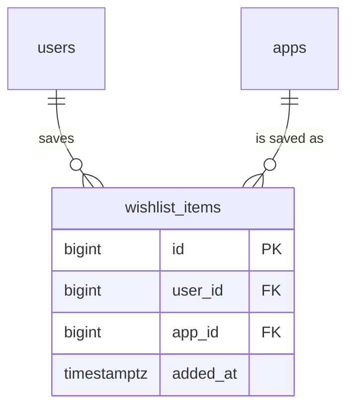

# FEAT-002 — Wishlist — Database Design

Confirmed output of the `schema-designer` discipline (draft ERD →
advisory normalization review → batched migration plan) for the Paladin
wishlist. PostgreSQL 16 is the only datastore. This is an additive
change to the FEAT-001 schema: one new table, nine migrations already
applied (`000001`–`000009`), one new pair.

The design sources were `spec.md` (`REQ-019`–`REQ-025`, `REQ-029`,
`REQ-036`, `REQ-037`) and the existing schema on `feat/FEAT-001`
(`users`, `apps`, `cart_items`, `licenses` read from the migration
files).

## Phase 1 — Draft ERD

Only the new entity and the relations it needs are drawn; the other
FEAT-001 entities are unchanged and remain in `paladin/ERD.md`.



- `wishlist_items` is the saved app; there is no wishlist header. A
  buyer's wishlist is the set of rows where `user_id` matches — the same
  shape as `cart_items`, so no new aggregate lifecycle is introduced.
- `UNIQUE (user_id, app_id)` is the business key: one entry per buyer
  per app (`REQ-022`).
- `added_at` exists only to order the list newest-saved first
  (`REQ-010`); `id` breaks the tie when several apps are saved in the
  same transaction and therefore share `now()`.
- No display columns: name, publisher, category, cover, price and
  rating are read live from `apps`/`categories` so a price change and a
  catalog edit are reflected on the next load (`REQ-009`, `REQ-021`,
  `REQ-032`, `REQ-036`).

## Phase 2 — Normalization review (advisory)

| Question | Verdict |
|---|---|
| Repeating group / multi-valued column? | None. One row per saved app, which is the multi-value. No array or JSON column. |
| Partial dependency? | The key is `(user_id, app_id)` for the business rule; `added_at` depends on the pair, not on `user_id` alone. Nothing to split off. |
| Transitive dependency on app display fields? | Deliberately not stored. `app` attributes stay in `apps`; the wishlist row is the relationship, so the table is in BCNF on `(id)` and `(user_id, app_id)`. |
| Duplicate of `cart_items`? | No merge. Same shape, different lifecycle and different rules (a cart is capped at 20, a wishlist is uncapped; a cart is a purchase intent, a wishlist is a save). Folding them into one table with a `kind` column would make every cart query filter a flag and would couple the two features (`REQ-029`). |
| Soft delete or audit columns? | Not needed. Remove is a physical `DELETE`; re-saving later is a fresh save with the current timestamp, which is the desired behaviour (`REQ-004`, `REQ-010`). No consumer reads removed rows. |
| `updated_at`? | Not added. The row has no mutable attributes — display fields are live and `added_at` is immutable; re-saving an existing app is a documented no-op (`REQ-003`). A column that never changes is noise. |
| Denormalized saved-state on `apps`? | Not possible and not wanted: saved state is per buyer, so it belongs in the relationship table, not the catalog. |

**Surrogate key.** `id BIGINT GENERATED ALWAYS AS IDENTITY` is kept even
though `(user_id, app_id)` is unique. It serves two concrete purposes:
a deterministic tiebreak for newest-first ordering inside one
transaction, and a stable target for the index and for future
row-level tooling. Dropping it would force `ORDER BY added_at DESC,
user_id, app_id`, which orders same-instant saves by app id rather than
by save order — a weaker guarantee for `REQ-010`.

## Phase 3 — Migration plan

One batch, one pair, additive only.

**`000010_create_wishlist_items.up.sql`**

```sql
CREATE TABLE wishlist_items (
    id       BIGINT GENERATED ALWAYS AS IDENTITY PRIMARY KEY,
    user_id  BIGINT NOT NULL REFERENCES users (id) ON DELETE CASCADE,
    app_id   BIGINT NOT NULL REFERENCES apps (id) ON DELETE CASCADE,
    added_at TIMESTAMPTZ NOT NULL DEFAULT now(),
    UNIQUE (user_id, app_id)
);

CREATE INDEX wishlist_items_app_id_idx ON wishlist_items (app_id);
```

**`000010_create_wishlist_items.down.sql`**

```sql
DROP TABLE wishlist_items;
```

Notes:

- `UNIQUE (user_id, app_id)` creates the index that serves both the
  lookup and the `ON CONFLICT (user_id, app_id) DO NOTHING` insert
  (`REQ-003`, `REQ-022`). A separate `(user_id)` index would duplicate
  its leading column and is not created.
- `wishlist_items_app_id_idx` mirrors `cart_items` and covers the
  cascade when an app is deleted and the checkout delete by `app_id`.
- Both foreign keys are `ON DELETE CASCADE`: deleting a user or an app
  must not leave an orphan row. There is no restart identity and no
  sequence sharing.
- Column names match `cart_items` (`user_id`, `app_id`) so the store
  code and the SQL read the same way.
- **No backfill.** There is no prior wishlist data anywhere; the table
  starts empty.
- **No seed change.** The seed command stays as is.

## Migration ordering and rollback

- Apply after `000009`; the pair is independent of every other
  migration and is the last one in the run.
- `down` is a plain `DROP TABLE`. It removes only this feature's data;
  no other table references `wishlist_items`.
- Round-trip must be clean: `migrate up` → `migrate down 1` →
  `migrate up` leaves the schema identical to a fresh run.

## Validation criteria (for the implementer)

1. **Cascade flags.** `SELECT confdeltype FROM pg_constraint WHERE
   conrelid = 'wishlist_items'::regclass` returns `c` for both foreign
   keys.
2. **Idempotent save.** Two `INSERT … ON CONFLICT (user_id, app_id) DO
   NOTHING` for the same pair leave exactly one row, and the second
   affects zero rows.
3. **Ordering tiebreak.** Inserting two rows for one buyer inside a
   single transaction and ordering by `added_at DESC, id DESC` returns
   them in reverse insertion order.
4. **Cascade deletes.** Deleting the user or the app removes the
   matching `wishlist_items` rows and nothing else.
5. **Unique scope per buyer.** Two buyers can both save the same
   `app_id`; a third insert for the same buyer and app is rejected by
   the constraint.
6. **Round-trip.** `up` → `down 1` → `up` completes without error and
   the table definition is unchanged.
